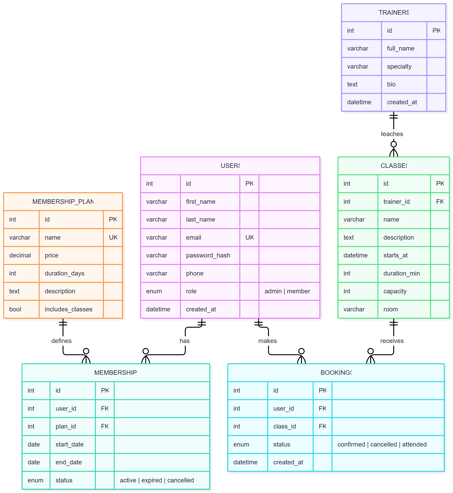

# Entity-Relationship Diagram (draft, Milestone 1)

   

## Planned business rules (for Milestone 3)

- A user cannot book the same class twice.
- A class cannot have more confirmed bookings than its `capacity`.
- A user needs an active membership whose plan has `includes_classes = true` to book.
